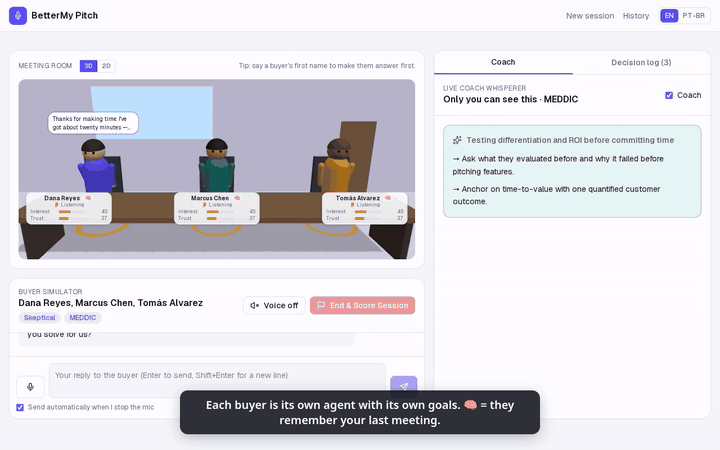
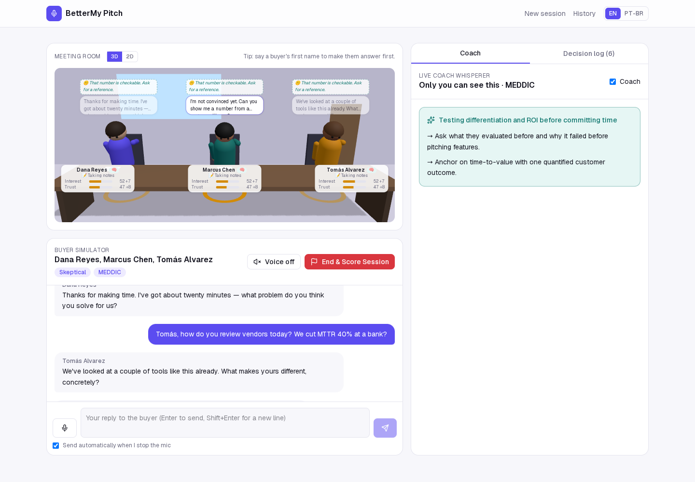
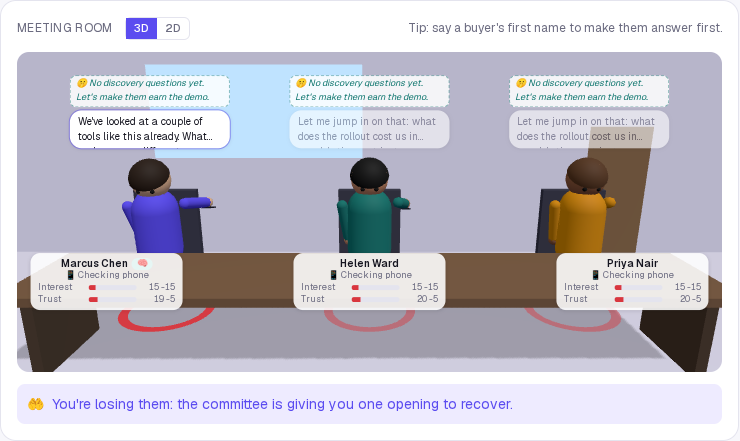

# BetterMy Pitch 🎤

**An AI sales & demo coach.** Rehearse product demos and sales pitches against a realistic AI buying committee, get silent coaching cues in real time, and finish every session with a structured scorecard: readiness score, category breakdown, quote-level key moments and executive-ready rewrites.

Built for sales engineers, founders and account executives who want reps before the real call.

## Demo

[](docs/demo/bettermy-pitch-demo.mp4)

**[Watch the 86-second demo video (MP4)](docs/demo/bettermy-pitch-demo.mp4).** A seller sets up a pitch, meets a 3-buyer committee that remembers their last meeting, asks a sharp question, rambles (the committee cuts in and loses interest), recovers with a number, checks the decision log and the private whispers, and ends with the committee's vote and an evidence-checked scorecard.

It was recorded with the offline mock provider, so the buyers' lines are canned. Re-record it against a live model with [`scripts/record-demo.mjs`](scripts/record-demo.mjs).

## Features

| | |
|---|---|
| **Scenario & persona builder** | Describe your product (or paste deck notes), pick a buyer persona (Skeptical VP of Engineering, Budget-Conscious CFO, Busy Startup Founder, Enterprise Security Lead, Procurement Manager) or write your own and save it as a template. Choose the difficulty (Cooperative / Skeptical / Hostile), sales framework (MEDDIC, SPIN, Challenger, or your custom demo flow) and language (English, Português, Español). |
| **Buying committee** | Add up to 2 colleagues to the main persona (e.g. VP Engineering + CFO + Security Lead). Each buyer is its own agent with its own goals. Members decide one after another, so they hear each other in the same round: they back each other up, disagree, address a colleague by name, or stay silent. Say a buyer's first name to make them answer first. |
| **Whispers (agents coordinate)** | Each buyer can pass a private note to colleagues every round ("He dodged pricing twice, push on it"). Colleagues read the notes before their next move. Whispers appear as dashed bubbles in the room and in the decision log when reasons are shown. |
| **Adaptive pressure** | Before each round, the committee adapts to how the seller is doing. Rambling (over 120 words) makes them cut in and ask for the short version. Doing well (high interest and trust) makes them raise the bar with harder questions. Losing the room makes them offer one clear opening to recover. A banner in the room shows the current mode. |
| **Memory across runs** | Built-in personas remember earlier scored meetings with this seller: how many, where their interest and trust ended, their last private thought, their vote, and the seller's weakest category. They bring it up ("Last time you couldn't tell me…"), and their starting trust moves up to ±10 points depending on how the last meeting ended. A 🧠 "Remembers you" badge shows on their seat. |
| **3D meeting room** | The committee sits across a boardroom table from you (the camera), in three.js. Each decision is acted out: leaning in, taking notes on a notepad, nodding, looking at a phone, crossing arms, shaking their head, turning to the colleague they address, and standing up and walking out the door. A floor ring shows interest (green / amber / red) and brightens while they talk. Speech and whisper bubbles float above each head; name, action and interest/trust meters sit on the table. A **3D / 2D** switch keeps the flat view; the room falls back to 2D if WebGL can't start. |
| **Meeting room (2D)** | Every decision shows on screen: each buyer's posture and body language (leaning in, arms crossed, checking phone, ready for a next step), animated interest and trust meters with the change from the last round, and who they are talking to. A buyer whose interest collapses can leave the meeting. If everyone leaves, the call is over. |
| **Decision log** | A tab next to the coach lists every buyer's move per round, including silent ones: action, interest and trust before → after, and a private one-line reason ("Marcus crossed his arms because the seller quoted price before asking about budget"). Reasons can be hidden for harder practice. |
| **Roleplay arena** | Split screen. **Left:** the buyer simulator stays strictly in character, asks hard technical and commercial questions and raises realistic objections. **Right:** the live coach whisperer reads each buyer turn and suggests 1–2 tactical pivots. |
| **Voice practice** | Browser Web Speech API: dictate your answers with the mic (optionally auto-sent) and have the buyers' replies read aloud, with a different voice (or pitch) per buyer. Needs Chrome or Edge; Safari support is partial. Text chat always works. |
| **Committee verdict** | When the seller ends the meeting, every buyer votes in parallel (advance, needs more, or reject) with a one-line reason and the objections that drove the vote. Each objection is marked handled or not, with the seller's exact words checked against the transcript. The majority decides the result: **Deal advanced**, **Deal stalled** or **Deal lost**. A buyer who walked out always votes reject. |
| **Scorecard & debrief** | "End & Score Session" runs the evaluator agent on the full transcript, the chosen framework and the committee's final state. It returns schema-validated JSON: an overall readiness score (0–100); Discovery, Objection Handling, Value Articulation and Conciseness/Pacing scores; framework coverage; key moments; side-by-side rewrites; next drills. Every quoted line is checked against the transcript and marked **Verified** (click to jump to the line) or **Not found**. A committee card shows where each buyer started and ended. |
| **Bilingual interface** | English and Brazilian Portuguese, switched with the **EN / PT-BR** selector in the header. The choice is saved in a cookie; on the first visit it follows the browser language. The practice language (buyer and feedback) follows the interface by default and can still be set per session. |
| **History & progress** | Sessions, transcripts, coach cues and scorecards are stored in SQLite. The home page charts your readiness score over time. |

## Architecture

```
Browser (Next.js App Router, React 19, Tailwind)
│
│  /                 Session configurator + history/progress
│  /session/[id]     ChatArena (buyer) │ LiveCoachSidebar (coach)   ← Web Speech API
│  /scorecard/[id]   ScorecardView
│
▼  fetch (JSON)
Route Handlers ─────────────────────────────────────────────────────────────
  POST /api/sessions   create session (+ optional persona template)
  POST /api/roleplay   one meeting round: each committee member's buyer agent → BuyerDecision
                       (say, addressedTo, action, interest, trust, reasoning); saved atomically
  POST /api/hint       Live Coach agent on the latest buyer turns + committee state (structured JSON)
  POST /api/evaluate   Evaluator agent on full transcript → Scorecard (structured JSON)
│                          │
▼                          ▼
Prisma + SQLite        src/lib/agents.ts ── src/lib/prompts.ts (Buyer / Coach / Evaluator)
(Session, Message,         │
 Decision, Scorecard,      ▼
 PersonaTemplate)      src/lib/llm  — provider layer
                         ├─ openrouter  (default: Claude Haiku 5.5 chat, Claude Sonnet 5.5 eval)
                         ├─ anthropic   (direct Claude API)
                         ├─ gemini      (@google/genai)
                         └─ mock        (offline, deterministic — for demos & CI)
```

**Agent loop.** Each round, every buyer still in the room observes the transcript and the visible state of their colleagues, then returns a `BuyerDecision`. The server clamps interest/trust swings to ±25 per round, normalises who was addressed, and stores one `Decision` row per member (silent members included). The coach reads those private states; the evaluator reads the final ones.

**Structured output.** The buyer, coach and evaluator schemas are written once in zod (`src/lib/schemas.ts`). From them the app builds a strict JSON Schema for each provider's native structured-output mode: OpenRouter `json_schema`, Anthropic `output_config.format`, Gemini `responseJsonSchema`. Every reply is validated again with zod. If a reply is invalid, the model gets one retry with the validation error attached. If an OpenRouter model doesn't support `json_schema`, the request falls back to schema-in-prompt.

**Model tiers.** Two tiers. A fast `chat` model handles buyer and coach turns, because latency matters mid-conversation. A stronger `eval` model writes the scorecard.

## Screenshots

| 3D meeting room | Losing the room (phones out, red rings) |
|---|---|
|  |  |

Committee verdict and scorecard: [docs/screenshots/scorecard-verdict.png](docs/screenshots/scorecard-verdict.png). Screenshots use the offline mock provider.

## Hackathon checklist

How BetterMy Pitch meets the [Multiplayer AI hackathon](https://crewbasecollective.com/aim-hack-visual/tracks.html) rules (Track 03, Grow with Agents):

| Requirement | Where |
|---|---|
| Characters with a visual identity | Avatars in the meeting room, one per buyer |
| Visual output: a running simulation | The live meeting room |
| Movement & action, not just text | Posture and body-language animation, meters, speech and whisper bubbles, buyers leaving the room |
| 3+ agents with their own goals | A 3-buyer committee by default, plus the live coach and the evaluator |
| Decision log | The decision log tab: action, interest/trust before → after, private reason, whisper and committee adaptation for every buyer, every round |
| Agents play expert roles as visible characters | The buying committee (VP Eng, CFO, Security Lead…) and the coach |
| 2–3 agents coordinate about the human | Buyers hear each other within a round and whisper private tactics to each other |
| Agents adapt to the human's performance | Adaptive pressure (raise the bar, interrupt, ease off) plus per-buyer interest and trust |
| A clear result with evidence-based feedback | The committee verdict (advanced / stalled / lost) with quote-verified objections, plus the scorecard |
| Booster: memory that changes decisions | Memory across runs changes starting trust and what buyers ask about |
| Booster: 3D | The 3D meeting room (three.js), default view |
| Booster: voice | A different browser voice (or pitch) per buyer |

## Getting started

Requirements: Node.js 20+ (CI uses 24) and npm.

```bash
git clone https://github.com/dartsqual/BetterMy_Pitch.git
cd BetterMy_Pitch
npm install                 # also runs `prisma generate`
cp .env.example .env        # then add your OPENROUTER_API_KEY
npx prisma migrate dev      # creates prisma/dev.db
npm run dev                 # http://localhost:3000
```

> No API key yet? Set `LLM_PROVIDER="mock"` in `.env` to click through the full flow with canned buyer, coach and scorecard replies.

> npm 11+ may print an `allow-scripts` warning. The Prisma install scripts are already approved under `allowScripts` in `package.json`.

### Environment

| Variable | Default | Purpose |
|---|---|---|
| `LLM_PROVIDER` | `openrouter` | `openrouter`, `anthropic`, `gemini` or `mock` |
| `OPENROUTER_API_KEY` | – | Key from https://openrouter.ai/keys |
| `OPENROUTER_CHAT_MODEL` | `anthropic/claude-haiku-5.5` | Buyer + coach model (any OpenRouter model id) |
| `OPENROUTER_EVAL_MODEL` | `anthropic/claude-sonnet-5.5` | Scorecard model |
| `ANTHROPIC_API_KEY` / `ANTHROPIC_CHAT_MODEL` / `ANTHROPIC_EVAL_MODEL` | `claude-haiku-5-5` / `claude-sonnet-5-5` | Direct Anthropic |
| `GEMINI_API_KEY` / `GEMINI_CHAT_MODEL` / `GEMINI_EVAL_MODEL` | `gemini-2.5-flash` | Direct Gemini |
| `DATABASE_URL` | `file:./dev.db` | SQLite file, relative to `prisma/` |

### Scripts

| Command | What it does |
|---|---|
| `npm run dev` | Dev server |
| `npm run build` / `npm start` | Production build / serve |
| `npm test` | Vitest (schemas, prompt builders, JSON extraction, retry logic) |
| `npm run lint` / `npm run typecheck` | ESLint / TypeScript |
| `npm run db:migrate` / `npm run db:deploy` | Prisma migrations (dev / prod) |

## Project structure

```
prisma/schema.prisma            Session, Message, Decision, Scorecard, PersonaTemplate
src/app/page.tsx                Landing + configurator + history/progress
src/app/session/[id]/page.tsx   Live roleplay + coach
src/app/scorecard/[id]/page.tsx Post-session analytics & rewrites
src/app/api/{sessions,roleplay,hint,evaluate}/route.ts
src/components/                 PersonaSelector, SessionConfigurator, SessionArena, MeetingRoom, Room3D,
                                ChatArena, LiveCoachSidebar, DecisionLog, ScorecardView, ProgressChart, ui
src/lib/committee.ts            Committee members, state, speaking order, swing clamping
src/lib/evidence.ts             Matches scorecard quotes to transcript lines
src/lib/prompts.ts              System prompts for the buyer agents, Coach, Evaluator
src/lib/schemas.ts              zod input/output schemas
src/lib/agents.ts               Committee round / Coach / Evaluator calls
src/lib/llm/                    Provider layer (OpenRouter, Anthropic, Gemini, mock)
src/lib/i18n/                   UI translations (en, pt) + locale cookie helpers
tests/                          Vitest suites
```

## Roadmap

- **Bruin analytics:** ingest sessions and scorecards into a warehouse with a [Bruin](https://getbruin.com) pipeline, for team-level dashboards (score trends per rep, persona and objection type). Moving `DATABASE_URL` to Postgres makes that a direct ingestion.
- Streaming buyer replies, and auth for multi-user teams.
- PDF and PPTX deck upload as product context.
- LLM observability: tracing the three agents and scoring with Datadog LLM Observability.

---

> `nocpilot-legacy/` holds NocPilot, the incident-management template that was in this repository before BetterMy Pitch. It was moved there unchanged; its GitHub workflows are disabled (kept under `nocpilot-legacy/github/`).
